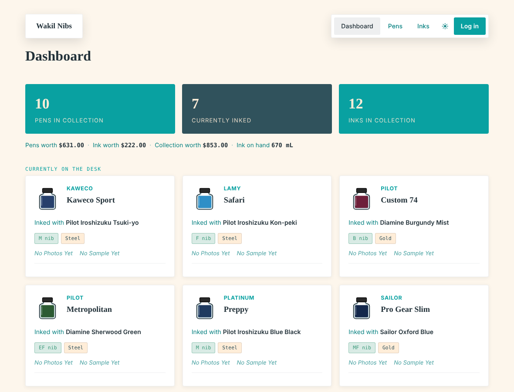
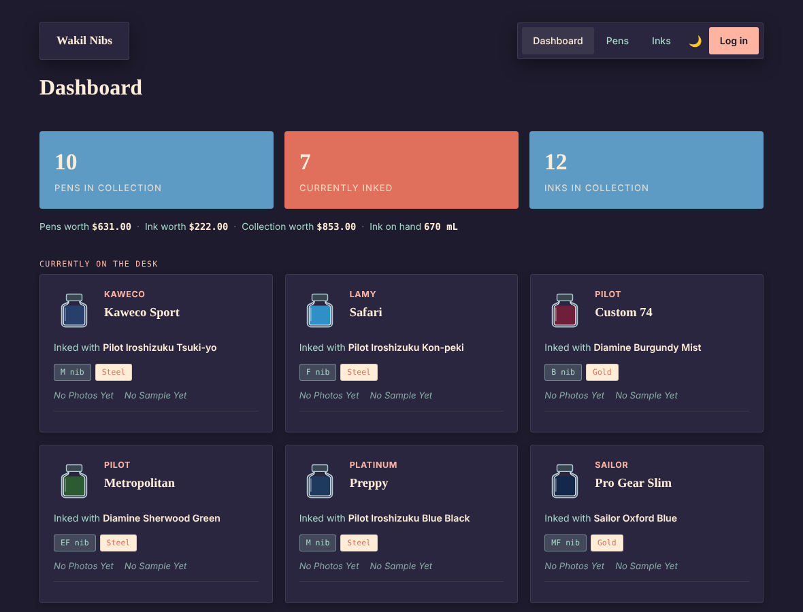
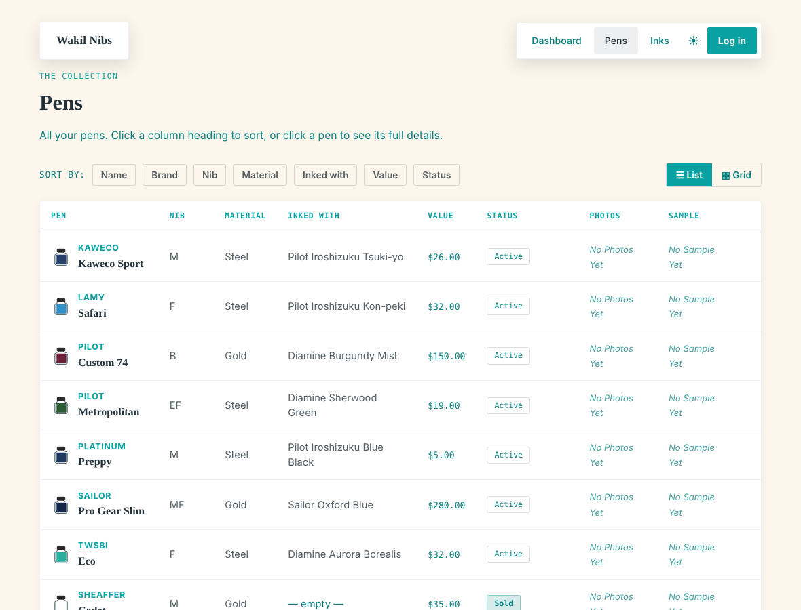
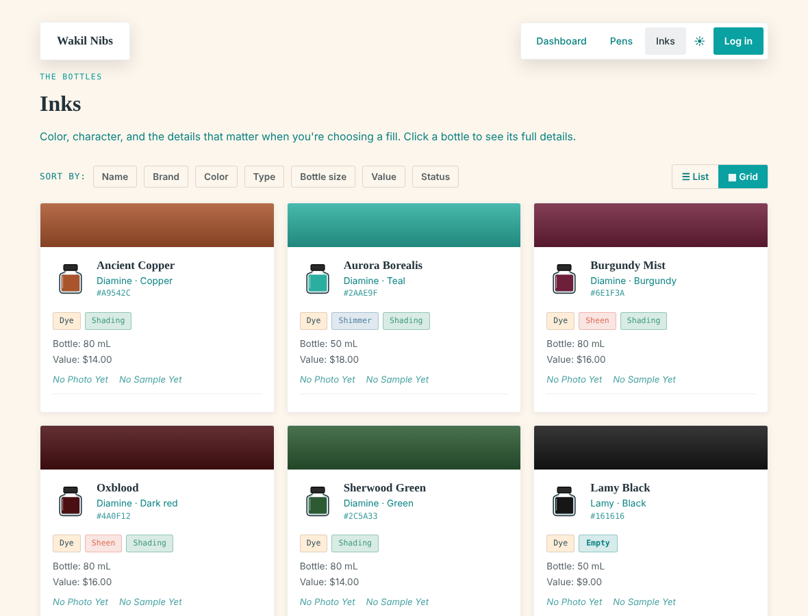

# Wakil Nibs

Self-hosted tracker for fountain pens and inks. Flask and SQLite, one editing
password, no accounts. Anyone can browse the collection; only you can change it.

You get a dashboard of what's inked right now, detail pages with photos and
handwriting samples, a value and status for every pen and ink (loaned, being
serviced, sold, empty and so on), running totals for pens, ink and mL on hand,
and light and dark themes. Inks show up as little bottles in the ink's color.



<details>
<summary>More screenshots</summary>





</details>

(Sample data, not a real collection.)

## Try it

Python 3.8 or newer.

```bash
git clone https://github.com/ItsWakil/wakil-nibs.git
cd wakil-nibs
python3 -m venv venv
source venv/bin/activate        # Windows: venv\Scripts\activate
pip install -r requirements.txt

export PENTRACKER_PASSWORD="pick-something"
export PENTRACKER_SECRET_KEY="a-long-random-string"
python app.py
```

Then go to http://127.0.0.1:5000. First run creates `pentracker.db` with one
sample pen and ink. Delete them when you've added your own, and use **Log in**
in the top bar to get the add/edit buttons.

If you leave out the two `export` lines the app still runs, but it warns you
and the password is `changeme`.

`python app.py` is the debug server. Don't leave it running for real.

## Running it on a server

Easiest is `bash setup.sh`. It sets up the venv, asks for a password, makes a
secret key, and can install a systemd service and write an nginx config for
you to look over. It doesn't touch your nginx setup itself.

To do it by hand:

1. Install as above, skip `python app.py`.
2. `cp .env.example .env` and fill in the password and secret key.
3. Copy `deploy/wakil-nibs.service.example` to `/etc/systemd/system/wakil-nibs.service`
   and fix the paths and user.
4. `sudo systemctl daemon-reload && sudo systemctl enable --now wakil-nibs`
5. It listens on `127.0.0.1:8000`. Put nginx in front (`deploy/nginx.conf.example`
   is a starting point) and get a certificate with certbot. Without HTTPS the
   password goes over the wire in plain text.

nginx can't run Python, it just forwards to gunicorn.

## Security notes

- Every form has a CSRF token, login redirects only go to paths on the site,
  and five wrong passwords from one IP locks that IP out for 15 minutes. The
  lockout lives in memory per worker, so a restart clears it.
- Behind nginx, set `PENTRACKER_TRUST_PROXY=1` so the lockout sees real IPs.
  `setup.sh` does this for you. If you use `.env`, it's in `.env.example`.
- Once you're on HTTPS, set `PENTRACKER_SECURE_COOKIES=1`.
- Use a long random password. It's a single shared password with no 2FA.
- Found a hole? Open an issue, or use GitHub's private security advisory if it's serious.

## Your data

Two things hold everything: `pentracker.db` and the `static/uploads/` folder.
Copy both to back up. Neither is tracked by git.

## Updating

Pull or copy the new code over, don't touch the database or uploads, and restart
the service. Gunicorn caches templates, so a restart is needed for any change.
If the page comes up unstyled, `static/css/style.css` didn't get copied (nginx
serves it straight from disk).

## Odds and ends

- Settings are still named `PENTRACKER_*` and the database is `pentracker.db`,
  from before the app had a name. Renaming them would break existing installs.
- Want the collection private too? Put nginx basic auth in front.

MIT licensed, see [LICENSE](LICENSE).

Made by [Wakil](https://wakil.ink) · [GitHub](https://github.com/ItsWakil)
